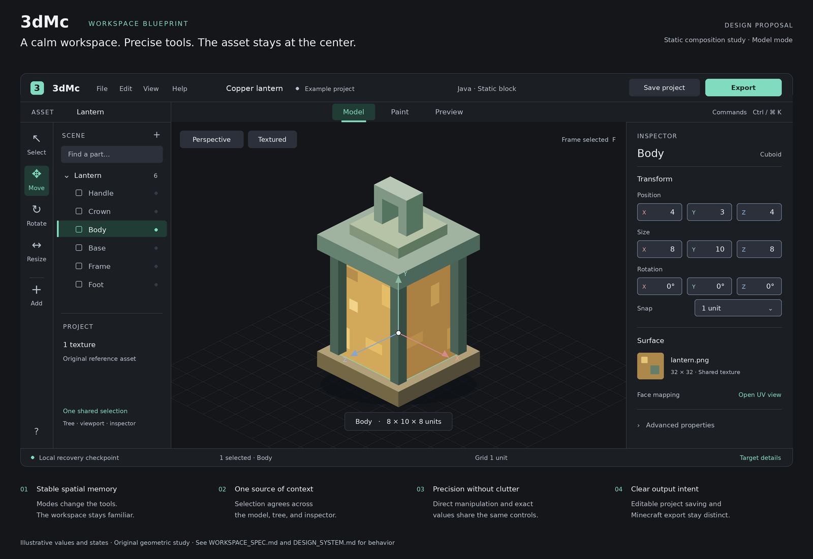

# 3dMc planning guide

**Status:** proposed foundation, prepared 2026-11-08. The editor is implemented on main with per-face UV authoring and a staged recovery/gesture hardening update; no Minecraft compatibility, device performance, or usability gates have been established. See [First implementation](delivery/FIRST_IMPLEMENTATION.md).

## The central decision

Build a professional Minecraft authoring workspace around one reliable loop: **create or import → model → paint → preview → validate → export → reopen**. Start with a narrow compatibility profile and hold the implemented loop to the intended product standard.

“All things Minecraft” is the long-term platform direction. It is not a claim that a single geometry format, preview renderer, or export path can represent every Minecraft asset.

## Reading paths

**Current expansion milestone:** [Full-scale expansion plan](delivery/FULL_SCALE_EXPANSION_PLAN.md). This is the working reference for next-cycle priorities and completion criteria, reviewed against `main` at `552b14466f258a308b575a9bcd3717527aab18a1`. It keeps the older roadmap and backlog available for reconciliation in the first cycle.

For a product review, read the [product brief](product/PRODUCT_BRIEF.md), [workspace specification](design/WORKSPACE_SPEC.md), and [roadmap](delivery/ROADMAP.md).

For implementation, start with the [decision register](decisions/DECISIONS.md), [technical design](architecture/TECHNICAL_DESIGN.md), [compatibility strategy](architecture/COMPATIBILITY.md), and [backlog](delivery/BACKLOG.md). The [quality gates](delivery/QUALITY_GATES.md) define completion.

For design, pair the workspace specification with the [design system](design/DESIGN_SYSTEM.md). Evaluate complete task flows, including empty, interrupted, unsupported, and recovery states.

For portable editable source projects, use the [native project archive contract](architecture/NATIVE_PROJECT_ARCHIVE.md). Evaluate GPU resource cleanup and recovery failure evidence in the [resource and recovery baseline](delivery/RESOURCE_AND_RECOVERY_BASELINE.md). For pixel asset import/export, use the [PNG texture workflow](delivery/TEXTURE_WORKFLOW.md). For scene creation and keyboard editing, use [creator tools](delivery/CREATOR_TOOLS.md). For the publicly hosted application, use the [GitHub Pages deployment guide](delivery/PAGES_DEPLOYMENT.md) to check the production build and the repository's Pages source settings. Our normal editor smoke tests use Vite's dev server; a second suite now verifies the compiled site under the `/3dMc/` URL.

## Workspace direction

This is a static composition study, not an application screenshot. It illustrates the spatial hierarchy, shared selection, exact controls, and separate save/export actions. The values and states are examples; the written design specifications govern implemented behavior. The [editable SVG](design/workspace-blueprint.svg) is included alongside the image.

## Document ownership

| Subject | Source of truth |
| --- | --- |
| Audience, outcomes, scope boundaries | Product brief |
| Interaction behavior and visible terminology | Workspace specification |
| Tokens, components, visual and accessibility standards | Design system |
| State ownership, transactions, persistence, module contracts | Technical design |
| Edition/version rules, fidelity, and format evidence | Compatibility strategy |
| Sequence, staffing assumptions, and milestone dependencies | Roadmap |
| Release evidence, thresholds, and test procedures | Quality gates |
| Work-package dependencies and delivery acceptance | Backlog |
| Rationale and changes to foundational choices | Decision register |

If two documents disagree, use the source of truth for that subject and update the other document in the same change. A feature name in a future-stage table does not authorize including it in an earlier milestone.

## Proposed defaults

| Question | Working answer | Revisit trigger |
| --- | --- | --- |
| First audience | Java resource-pack creators and people making their first custom block visual | Early creator interviews show a different dominant use case |
| First asset | An original, opaque cuboid lantern used as a replacement visual for one existing block | The initial target block cannot produce a clean, reproducible proof |
| First game release | Select and pin an exact stable release during S0 | Fixture and in-game evidence, not a moving “latest” label |
| First device | Desktop and laptop, mouse or trackpad | Input studies justify tablet authoring |
| First architecture | Local-first React/TypeScript/Three.js application | A demonstrated workflow needs a server |
| First workspace | Model / Paint / Preview, with contextual UV tools | Task studies reveal mode confusion |

## What is ready and what still needs evidence

This documentation describes the product direction, architecture and implemented editor. The [Java 1.21.4 export experiment](compatibility/JAVA_1214_EXPORT.md) implements deterministic offline packaging and exact-subset import for one replacement block, with a face-aware UV extension. The [game check](evidence/java-1.21.4-2026-11-09/REPORT.md) records the fixtures tested in Minecraft.

The [backlog](delivery/BACKLOG.md) and [roadmap](delivery/ROADMAP.md) retain earlier planning ideas; current work should focus on concrete issues and the [testing notes](delivery/ALPHA_RELEASE_GATE.md).

Primary references and their scope are recorded in [research notes](research/SOURCES.md). Recommendations in this plan are product and engineering judgments unless explicitly identified as facts from those references.
