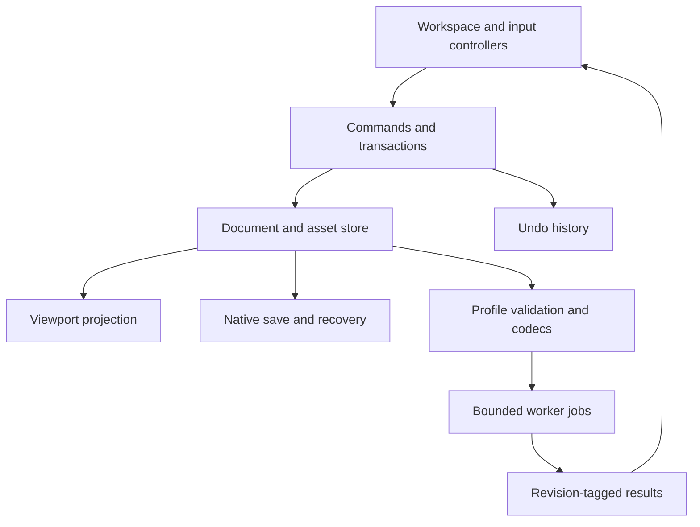

# Technical design

**Status:** Proposed implementation architecture. **Research date:** 2026-11-08. No application, performance measurement, or game compatibility result is implied by this plan.

The first application should make one complete authoring loop trustworthy: open an original cuboid lantern, reshape it, paint opaque pixels, save its editable source, reopen it, and export a verified resource-pack replacement for an existing Java block. The exact game release and replacement block are S0 decisions. This architecture supports that outcome while preserving clear places for Java items, Bedrock geometry, and animation later.

Build one Vite application with React, TypeScript, Three.js, and a thin React Three Fiber integration. Use internal modules and a single dependency lockfile. No backend, account, plugin host, or independently published package is necessary for S1. Vite documents a React/TypeScript starting template; the compatible dependency versions must be pinned and exercised when the application is scaffolded. See the [Vite guide](https://vite.dev/guide/) and [decision register](../decisions/DECISIONS.md).

## 1. Architecture and ownership

The editable document is the source of truth. React presents controls; the renderer presents a disposable spatial view; codecs translate between the document and external formats. Neither React component state nor a Three.js scene is the native file format.



Start with these source boundaries; they are directories, not separately released packages:

| Module | Owns | Dependency rule |
| --- | --- | --- |
| `editor/document` | Versioned data, IDs, invariants, migrations | No React, Three.js, or browser globals. |
| `editor/commands` and `editor/history` | Editing transactions, patches, undo/redo | Depend on domain and pixel operations. |
| `editor/capabilities` | Target profiles, operation availability, diagnostics | Describes meaning without constructing UI. |
| `features/model`, `paint`, `uv`, `preview`, `export` | User workflows and controllers | Invoke commands; do not mutate renderer objects as document edits. |
| `rendering` | Scene projection, picking, cameras, overlays, GPU resources | Reads domain snapshots and transient previews. |
| `textures` | Pixel buffers, brush operations, UV-to-pixel mapping | Independent of 2D or 3D input surfaces. |
| `io/codecs` and `io/project` | Game adapters and native archives | Consume validated snapshots; never own the live editor. |
| `persistence` and `workers` | Recovery, file adapters, job orchestration | Report completion and failure explicitly. |
| `ui` | Accessible primitives, menus, panels, tokens | Contains presentation, not compatibility rules. |

Enforce dependency direction with lint rules once the modules exist. Avoid building an abstract service framework around each function. Introduce an interface when there is a real boundary to test or replace: renderer projection, storage adapter, codec, and worker transport are useful examples.

## 2. Canonical document and asset data

Use a normalized, serializable document with stable IDs. The following sketch establishes ownership, not a complete public schema:

```ts
type Id = string;
type Vec3 = readonly [number, number, number];

interface EditorDocument {
  schemaVersion: number;
  id: Id;
  revision: number;
  target: { profileId: string; profileVersion: number };
  roots: Id[];
  nodes: Record<Id, CuboidNode | GroupNode>;
  textures: Record<Id, TextureRecord>;
  sourceRefs: Record<Id, SourceReference>;
}

interface CuboidNode {
  id: Id;
  kind: "cuboid";
  name: string;
  from: Vec3;
  to: Vec3;
  pivot: Vec3;
  rotation: ElementRotation;
  faces: Partial<Record<FaceDirection, FaceBinding>>;
}
```

`ElementRotation` identifies the mathematical convention and preserves relevant source encoding separately. `FaceBinding` carries texture identity, UV mapping, and supported face metadata. `TextureRecord` contains dimensions, color/alpha interpretation, and an immutable blob reference. Large pixel arrays live in an asset store, outside ordinary React state and JSON serialization. They become project-owned blobs in a native archive. A group initially owns child IDs and organization metadata; it does not imply an exportable transform or bone.

Validate finite numbers, IDs, references, hierarchy cycles, image extents, and profile invariants at every external boundary. TypeScript cannot validate imported JSON. Keep coordinate mapping explicit: the proposed editor convention is Y up, north along negative Z, and 16 model units per block. The renderer may apply a scale at its boundary. Detailed transform and UV contracts belong in [compatibility](COMPATIBILITY.md).

Source provenance records the resource path, codec/profile, original content reference, and understood metadata. Unknown fields remain in a source sidecar only where the adapter can explain their preservation. Renaming or deleting an element may invalidate an unknown reference. An untouched original can be retained without claiming that every edited export remains lossless.

Do not add placeholder bone, timeline, arbitrary mesh, or distributed-editing structures to S1. Introduce a discriminated asset representation and native schema migration when a later family has real fixtures and requirements. Keep document construction and validation executable without a browser or GPU.

## 3. Four state lifetimes

Separating state by lifetime prevents accidental saves, duplicate sources of truth, and render work unrelated to an edit. React's [state structure guidance](https://react.dev/learn/choosing-the-state-structure) supports avoiding redundant and contradictory state.

| State | Examples | Persistence and updates |
| --- | --- | --- |
| Document | Geometry, texture pixels, names, target, authored metadata | Commands, history, native save, recovery. |
| Session | Selection IDs, active tool, camera, panel sizes | Lightweight preference/session storage where useful; excluded from ordinary document undo. |
| Gesture | Drag origin, pending numeric text, brush samples, preview overlay | Short-lived controller state; commit or cancel. |
| Derived | Scene objects, bounds, thumbnails, validation results | Rebuildable caches keyed by revision and inputs. |

Use an external editor store with narrow subscriptions and React's supported subscription mechanism. Select a small state library, or a minimal implementation, through the S0 subscription spike. Do not put the whole document into a context value that rerenders every panel on every pointer event. R3F specifically cautions against high-frequency React state updates in its [performance guidance](https://r3f.docs.pmnd.rs/advanced/pitfalls).

Every committed document change receives a new monotonic revision, including undo and redo. Track content identity or saved history position separately so undoing back to saved content can clear the dirty indicator. Async diagnostics carry the revision they inspected. A stale result may describe an old snapshot; it must never overwrite newer diagnostics or mutate the current document.

## 4. Commands, transactions, and history

All edit paths share commands: menus, keyboard shortcuts, numeric fields, gizmos, and automation inside the app. A command declares its affected IDs, capability requirement, mutation, inverse data, and user-facing label. Commands validate before committing, including when invoked without the normal UI.

A continuous gesture follows `begin → update preview → commit` or `cancel`. Capture initial geometry or affected texture tiles once. Pointer movement updates a transient working preview; releasing completes one transaction. Escape restores the initial state. Lost pointer capture, document switching, and conflicting edits have deliberate cancellation rules. Numeric text stays local until a valid commit; partial input such as a minus sign must not corrupt geometry.

One drag, stroke, duplicate operation, texture resize, or multi-object property change becomes one undo entry. A resize that changes both image and UV data is atomic. Selection may follow the result as a session effect, but camera orbit and panel layout do not consume model history. A committed edit after undo clears redo. No-op gestures create no entry.

For geometry, store compact before/after records or reversible patches. For painting, capture changed tiles once per stroke and store before/after bytes; overlapping brush samples must not duplicate the entire image in history. Start with a measured tile size and memory budget. Evict the oldest history entries only at transaction boundaries and disclose the available undo depth. Recovery checkpoints are separate from interactive history; do not imply that reopening restores unlimited undo.

The commit event drives dirty state, history, diagnostics, render invalidation, and recovery scheduling. If validation fails, the document remains unchanged and the error identifies the control or object. Async operations calculate a proposed patch against a captured base revision, then pass through the same commit path. If their base is obsolete, discard or recompute; do not silently apply old pixel results to a newer texture.

## 5. Shared texture engine and UV mapping

S1 has an opaque Pencil and Eyedropper working in both the texture panel and viewport. A CPU pixel engine is the authoritative editor of RGBA bytes. Both surfaces produce the same pixel-operation inputs, so brush behavior, undo, export, and color sampling agree. Layers, erasing, alpha authoring, fill, and advanced compositing follow measured memory behavior and a verified target profile, provisionally in S2.

The 2D path converts panel coordinates through zoom/pan into texture pixels. The 3D path resolves a stable object and semantic face ID, converts the hit through that face's UV mapping, and then uses the same pixel path. Explicitly handle edge hits, rotated/mirrored UVs, and shared texture regions. Painting a shared region changes every face that references those pixels; show that relationship instead of implying independent per-face copies.

Interpolate a stroke in texture space within a continuous mapping. Crossing faces or UV islands must not draw an unintended line through unrelated texture areas. Define whether the current gesture continues across a seam, starts a new segment, or stops at the face boundary. Test this policy with deliberately asymmetric textures, not only a checkerboard. Eyedropper samples the authoritative texture pixel, not a lit framebuffer color.

For the initial engine, record straight RGBA pixel semantics and an explicit sRGB interpretation for color textures. Any canvas or image-decoder conversion must be verified by pixel fixtures. Three.js documents a linear working color space and the need to identify color texture and output color spaces in its [color-management manual](https://threejs.org/manual/pages/color-management.html). Configure the rendering boundary accordingly; do not compensate for a color error by changing source pixel values.

Use a nearest-filtered, unlit inspection mode for pixel and UV work, with explicit sampling settings. A separate reference-lighting preview helps assess volume but must state its supported lighting, shading, and material behavior. It is not proof of game equivalence. Avoid postprocessing in the color-truth inspection mode. The selected game profile and in-game fixtures determine which material behavior can be called accurate.

Update only dirty texture regions where the measured rendering path permits it, and coalesce uploads to the frame cadence. Do not encode a PNG after every pointer sample. The renderer's texture is a cache of the pixel buffer; losing the GPU context must not lose authored pixels.

## 6. Viewport and interaction controller

Maintain a stable map from domain IDs to render objects, including semantic face IDs for picking. Derive geometry from canonical coordinates and preserve source face labels independently from transformed normals. Selection outlines, handles, and UV overlays are presentation; exclude them from export and ordinary scene picking.

The viewport controller owns orbit/pan/zoom, orthographic views, framing, ray casting, and gizmo gestures. It delegates actual edits to transactions. Gizmo snapping and numeric entry use the same units and constraints. The interaction contract must define screen-space handle size, occlusion priority, click-versus-drag thresholds, and the relationship between selection and navigation. Those choices are tested through the tasks in the [workspace specification](../design/WORKSPACE_SPEC.md).

Begin with a straightforward render object per editable cuboid. Add geometry reuse, batching, instancing, or spatial acceleration only when profiling identifies a cost, and retain stable picking and selection behavior. R3F documents demand rendering, invalidation, reuse, and instancing in [scaling performance](https://r3f.docs.pmnd.rs/advanced/scaling-performance). Use demand rendering when idle, requesting frames for camera motion, previews, texture updates, and interaction; do not let invalidation omissions create stale views.

Assign resource ownership explicitly. Replacing a document releases orphan geometry, materials, textures, render targets, and image handles without disposing resources still shared elsewhere. Three.js requires disposal of relevant GPU resources; see its [cleanup manual](https://threejs.org/manual/pages/how-to-dispose-of-objects.html). Handle context loss with a clear viewport state and reconstruct from the document. Saving source work should remain available when rendering fails.

## 7. Profiles and deterministic codecs

A profile contains edition, exact supported release/schema, asset family, supported operations, validation rules, codec identity, and preview limitations. Avoid conditionals such as `if targetName.includes("Java")` scattered across controls. The same capability facts explain disabled controls and drive export validation, while the final validator independently checks the entire snapshot.

A small codec boundary is sufficient:

```ts
interface AssetCodec {
  id: string;
  inspect(files: ImportSet): Promise<ImportReport>;
  decode(files: ImportSet, context: DecodeContext): Promise<DecodedAsset>;
  validate(snapshot: DocumentSnapshot, profile: TargetProfile): Issue[];
  encode(snapshot: DocumentSnapshot, context: ExportContext): Promise<ExportSet>;
}
```

`ImportSet` is a normalized virtual file set, not an ambient filesystem. `DecodeContext` supplies explicit dependencies, budgets, and cancellation. `ImportReport` distinguishes editable, view-only, and blocked content. `ExportSet` is a set of intended paths and bytes plus an explanatory report, before any download or file write. Issues carry stable codes, severity, resource/object/face references, and available actions.

Resolve parent, texture, and model references with cycle detection and an explicit resource context. Never auto-fetch an arbitrary remote dependency. Maintain deterministic resource ordering and numeric serialization, and define which metadata can be normalized. Test semantic import/export/import equivalence for the supported subset; byte-identical JSON is a separate, much narrower claim.

Capture one immutable document revision for validation and export. If the user continues editing, the output remains associated with that captured revision. Changing target runs compatibility analysis before committing the change. Any lossy conversion creates a reviewable report and reversible document operation; it is not hidden inside encoding. Detailed version facts and game-proof requirements are in [compatibility](COMPATIBILITY.md).

## 8. Native archive and recovery

Propose `.3dmc` as a ZIP container containing `manifest.json`, `document.json`, project-owned texture blobs, and optional source originals. The manifest identifies native schema version, project ID, asset references, checksums, and required features. File paths are normalized archive paths. This remains a private application format until migration and recovery fixtures establish a stable contract.

Native save preserves editable data; game export may flatten it. Neither output replaces the other. Future layers must remain native source even when an exporter writes one flattened PNG. Treat newer unsupported native versions as read-only or blocked with a useful explanation. Migrate a copy through explicit version steps, validate it, and retain the original until a successful save. Never overwrite a newer file after guessing its meaning.

Use IndexedDB for initial local recovery, with metadata and immutable asset blobs referenced by a checkpoint manifest. A recovery write publishes a new checkpoint only after all referenced data is present. Retain at least the current and previous verified checkpoints after publication, so corruption of the newest still leaves a recovery candidate. On startup, validate checksums/references and offer a named recovery with its timestamp and revision; do not silently replace a deliberately opened file.

Garbage collection computes reachability across every retained checkpoint and every protected in-flight operation. A blob referenced by any of those roots is live. Coordinate cleanup with checkpoint publication under the same ownership fence; do not decide reachability from only the newest manifest. If the minimum retained set cannot fit the quota, report the storage failure and offer native download rather than quietly removing the recovery guarantee. Test restoration of the previous checkpoint after the newest becomes unreadable and cleanup has run.

Serialize and coalesce recovery writes per project, with a bounded delay during continued editing. Atomically prevent an older save completion from replacing a newer checkpoint pointer. Each completion acknowledges only its captured project, open-session ID, and content revision; it can clear the active unsaved indicator only when that captured content matches the active content under the saved-content policy. Serialize writes to the same native file handle as well. Trigger an additional attempt on relevant lifecycle signals, but never depend on page shutdown to finish a write. Test reversed save-completion order, switching projects during a save, quota failure, aborted transactions, corruption, interrupted writes, and schema migration. MDN documents storage quotas, eviction, and persistence requests; a persistence grant still is not a portable backup: [browser storage behavior](https://developer.mozilla.org/en-US/docs/Web/API/Storage_API/Storage_quotas_and_eviction_criteria).

Report three independent states:

| State | Honest UI meaning |
| --- | --- |
| Local recovery | The workspace states “Saving…,” “Saved on this device,” “Unsaved changes,” and “Local save failed,” with the acknowledged checkpoint revision available in details. “Recovered” is used only after an actual restoration. |
| Native file | Last confirmed write, or “Download prepared/started” when completion is not observable. |
| Game export | Captured revision, target profile, validation result, and output delivery state. |

A supported file API can provide a direct write path; ordinary file input and download remain the baseline. Request permission as part of the user's file action and confirm successful close before reporting a completed write. See the [File System API](https://developer.mozilla.org/en-US/docs/Web/API/File_System_API). A downloaded file cannot be assumed to have been retained merely because its download was triggered.

Handle multiple tabs with a project writer lease and explicit takeover or “open a copy” behavior. Give ownership a monotonic generation token. Check owner and generation in the same IndexedDB transaction that publishes a checkpoint or performs destructive cleanup, so a suspended tab cannot resume and overwrite a new owner's work. A tab that loses ownership keeps its in-memory document and can download or fork it; it cannot publish into the original project. Test takeover followed by the former writer resuming. Consider OPFS later for larger assets only after measuring IndexedDB limits; it remains origin-private storage, not a user-managed backup ([OPFS documentation](https://developer.mozilla.org/en-US/docs/Web/API/File_System_API/Origin_private_file_system)). Offline reload is a separate capability with cache/update tests, not an automatic consequence of local editing.

## 9. Workers, cancellation, and responsiveness

Keep pointer response, selection, and small deterministic edits on the main thread. Offload work with demonstrated cost: archive inspection/decompression, large validation passes, image processing, compositing, and PNG/ZIP encoding. Start with a small worker pool managed by one scheduler rather than one worker per feature.

Every job carries `jobId`, document ID, open-session ID, base revision, operation kind, and budget. Results repeat those identifiers. Apply a policy according to the job's effect:

- Mutation patches require a current base revision and session. Discard or recompute obsolete patches.
- Diagnostics can be superseded or marked stale; an older result never replaces the current revision's result.
- Immutable snapshot exports may finish while later edits continue. Label their captured revision and profile, and do not mark newer work exported or saved.
- Recovery and native-file writes follow the serialized, ownership-fenced publication rules above.

Explicit cancellation or closing/switching the source project may cancel delivery; a result must never be applied or presented as belonging to an unrelated workspace. Chunk long tasks to observe cancellation; reserve worker termination for work that cannot cooperate. Transfer copies or exclusively owned buffers so detaching a buffer cannot destroy the live texture state. Bound queue length and simultaneous large allocations.

Progress describes work actually measurable, such as processed entries or encoded textures; indeterminate work remains indeterminate. A failed job leaves the document intact and offers retry or a smaller operation. Export and save workers operate on captured snapshots, while texture workers return patches that still require a valid transaction commit.

## 10. Import limits and safety

Treat every imported archive, JSON file, and image as untrusted data. Define one `ImportBudget` policy before enabling import: compressed bytes, total expanded bytes, entry count, per-entry size, nesting/dependency depth, JSON size, image dimensions, total decoded pixels, node count, and job duration. S0 sets numeric defaults from baseline-device measurements and records them with fixtures. These are application limits, not invented Minecraft restrictions.

Check archive metadata before allocation and enforce cumulative limits during expansion; declared sizes are not sufficient. Reject traversal paths, absolute paths, normalized duplicates, conflicting resource IDs, unsupported nesting, and unexpected executable content. Inspect image dimensions before allocating full pixel buffers where the decoder permits it, then verify the decoded result. Stop early with the offending entry and budget in the error.

Do not execute imported scripts, evaluate expressions as JavaScript, resolve external URLs automatically, or inject names/metadata as HTML. Later Molang support requires a restricted parser and a documented evaluation budget. Project imports should not require network access. Keep original file names as display data and use generated internal IDs for ownership.

## 11. Verification and performance evidence

Tests protect meaning and failure behavior. They should cover the complete path where a mistake could destroy work or produce an invalid asset:

| Layer | Essential evidence |
| --- | --- |
| Domain/history | A command followed by undo restores semantic content; redo repeats it; canceled/no-op gestures leave no entry; multi-object operations are atomic. |
| Geometry/UV | Transformed corners and normals, noncentral pivots, face IDs, asymmetric UV fixtures, mirrored/shared mappings, and exact pixel hits. |
| Texture | Known stroke pixels, 2D/3D operation equivalence, tile undo, sampling, decoder/encoder pixel preservation, and supported alpha behavior. |
| Codecs | Positive/negative fixtures, dependencies/cycles, unknown-field policies, deterministic output, and semantic round trips. |
| Persistence | Interrupted checkpoints, quota errors, migrations, corrupt blobs, stale saves, multi-tab ownership, and native reopen. |
| Product loop | Browser automation creates/edits/undoes/saves/reopens/exports; keyboard and focus behavior work; recorded game checks confirm the target output. |

Keep a small golden fixture set with provenance and expected semantics. Screenshot tests supplement numeric and pixel tests; they cannot prove model meaning or pack compatibility. Run actual game checks for every supported profile and relevant codec/material change. Record game version, fixture and application revision, output hashes, screenshots, and known preview differences.

Measure representative documents on named browser/device baselines. Track the input-to-render-submission proxy, frame-time percentiles during drag/paint, idle activity, memory growth across repeated opens, recovery duration, export duration, and output size. The [quality gates](../delivery/QUALITY_GATES.md) define measurement methods and thresholds, which remain proposed until measured. Display latency requires a separate display-aware measurement. Optimize the identified bottleneck, then rerun the same workload; do not adopt instancing, a GPU painting engine, or WebGPU merely as a badge of sophistication.

## 12. Delivery sequence

S0 proves the exact Java profile, UV/transform/color mapping, replacement block, storage strategy, and baseline budgets with small executable fixtures. It also selects compatible dependencies and tests the UI subscription model. Any disagreement between reference documentation and original game behavior becomes an explicit compatibility issue.

S1 implements the polished lantern loop: cuboid editing, opaque Pencil/Eyedropper, coherent history, native save/reopen, local recovery, constrained import, and the verified replacement pack. S2 broadens authoring, UV tools, and painting only after the memory and compatibility gates pass. S3 adds version-aware Java item definitions and production pack workflows. S4 introduces Bedrock geometry, then animation with its own evaluator and tests. S5 evaluates further asset families and extensions from actual demand.

The architecture is successful when each stage adds a capability without changing what a saved document, undo operation, or verified export means. A premium prototype depends on those promises being dependable from its first complete workflow.
