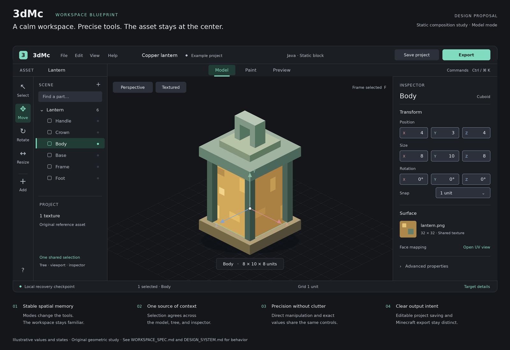
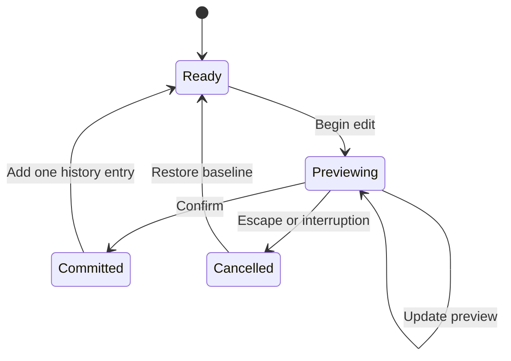

# Workspace specification

**Status: Proposed product contract.** This document describes the intended experience; it does not claim that the interface exists or that acceptance targets have been achieved. Research reviewed **2026-11-08**. Read alongside the [design system](DESIGN_SYSTEM.md). The [delivery backlog](../delivery/BACKLOG.md) maps these contracts to scheduled work packages, and [quality gates](../delivery/QUALITY_GATES.md) owns quantitative acceptance criteria.

## 1. The product promise

A creator should be able to understand what is selected, change it confidently, see the result immediately, and recover from a mistake without reconstructing their work. The editor should feel approachable because its behavior is coherent, not because professional controls have been removed.

Use one workspace with three task modes: **Model, Paint, and Preview**. Selection, project identity, undo history, and asset identity remain shared. Reveal additional controls when a selection, tool, or target format makes them relevant. There is no separate beginner interface, no mandatory tutorial, and no permanent wall of advanced settings. Expertise is rewarded with shortcuts and precision controls within the same interface.

The proposed first asset is an original, opaque, cuboid lantern. The first target is a static Java block visual, with the exact game version and one vanilla block replacement verified during S0. Export produces a resource pack replacing that existing block's visual model. It does not register a new block or imply changes to behavior, collision, or lighting. Java item support follows in S3. Bedrock profiles and applicable animation workflows follow in S4. Show only capabilities that the active, versioned profile supports.

Mature editors demonstrate the value of a stable scene hierarchy, task modes, contextual panels, and precise transforms. Blockbench documents all four, alongside UV and texture tools; these are reference workflows rather than a visual template for this product. [Source: Blockbench overview](https://blockbench.net/wiki/guides/blockbench-overview-tips/).

## 2. Workspace information architecture

The editor opens directly into a useful canvas. A separate marketing dashboard, social feed, account setup, or subscription interruption is outside the first creation loop.

| Region | Proposed default | Responsibility and contents |
| --- | --- | --- |
| Application bar | 48–56 CSS px high | Project menu and name, save status, undo/redo, active target profile, Export. The project menu holds open, native project download, and recovery. |
| Mode bar | 40 CSS px high | Model, Paint, Preview; the active mode is labeled and visually selected. Tool options occupy the remaining horizontal space when practical. |
| Scene panel | 244 CSS px wide; resizable | Scene hierarchy, filter, add element, visibility, locking. A small Assets tab exposes textures and imported dependencies. |
| Main work area | Remaining space | 3D viewport, compact tool rail, view controls, selection context. This is the dominant region. |
| Inspector | 296 CSS px wide; resizable | Selected object's identity, Transform, Appearance, and applicable advanced fields. Empty selection shows useful project context. |
| Paint surface | Contextual center split | Linked 2D texture view beside the 3D viewport. Its split position is remembered for Paint. |
| Status strip | 28 CSS px high | Current tool hint, useful selection information, and active operation status. Avoid permanent developer metrics. |

*Static design study: this blueprint illustrates the proposed region hierarchy and visual direction. It is not an implemented app or evidence of usability or accessibility conformance. The diagram uses illustrative chrome scale; real controls follow the design system’s 13–14 CSS px primary text and usable target sizes.*

At 1440 × 900, the initial viewport receives at least roughly half the available width. Validate the exact balance with real components and users. Panel minimum widths preserve readable labels and numeric fields. Panel collapse, resize, and **Reset workspace** ship in S1; arbitrary docking, detachable windows, and elaborate saved layouts wait until evidence shows a need.

The Model rail initially offers Select, Move, Rotate, Resize, and Add element. S1 Paint offers an opaque Pencil and Eyedropper; additional painting tools arrive only with complete behavior. Every icon has an accessible name, a tooltip, and a visible active state. Commands remain available through menus or labeled controls, so remembering an icon or shortcut is never a prerequisite.

Switching modes preserves selected element IDs, camera, texture, and unsaved work. It does not automatically center or rotate the camera. Selecting a different element changes inspector content without changing the panel's basic structure. **Frame selection** and **Fit asset** are explicit actions. No timeline is displayed for a static block project. UV is a contextual texture tool, not a fourth top-level mode. Animate becomes a mode only when an implemented profile supports animation.

## 3. Selection and hierarchy contract

The viewport and Scene panel represent the same selection. A selection must never appear in one place while another object receives edits elsewhere.

### S1: single selection and a dependable scene list

S1 selects one element at a time. Face selection is an explicit tool state for painting and linked UV inspection, shown beside the active tool and in the inspector. A primary click replaces the selection. Clicking empty canvas clears selection unless a tool gesture is underway. Selection respects visible surfaces. An obscured element remains reachable through the Scene panel; X-ray selection is not required in S1.

Hover, selection, keyboard focus, and locking have separate treatments. Hover previews a potential target; it does not change the inspector or dirty the document. The selected element has a persistent outline and a selected scene row. Keyboard focus uses a distinct ring.

The scene list supports predictable rename, duplicate, delete, hide, and lock actions for the selected element. Visibility and lock controls have stable positions and can be reached with keyboard focus. They are available without hovering. Hiding or locking an element changes editing visibility or editability, not whether it is included in export. If export inclusion is needed later, it is a separately named property.

### S2: richer selection and hierarchy

Multi-selection, grouping, hierarchy reordering, and optional X-ray selection belong to S2. They must not become prerequisites for completing the S1 lantern loop. When multi-selection ships, Ctrl/Cmd-click toggles membership and Shift-click selects a contiguous range in the hierarchy. Canvas Shift behavior must be defined in shortcut help and must not unexpectedly select an entire group. Selecting through geometry requires an explicit X-ray control whose state remains visible.

Multi-selection shows the selected count. Shared properties display their value; differing properties display **Mixed**. Entering a value replaces that property across the selection. Relative changes are offered as explicitly labeled operations. Group transform behavior and pivot rules require a documented capability decision before implementation; do not invent Blender-like object transforms if they cannot be represented in the target model. Reordering has visible insertion feedback and a single-pointer alternative to dragging.

Across stages, deletion, duplication, renaming, and any supported reordering are undoable. Deleting an ordinary element does not need a confirmation dialog. Destructive project replacement, irreversible format conversion, and clearing recoverable history do. Each such dialog names the affected asset and the consequence.

## 4. Editing transactions and precision

### Direct manipulation

A drag, a complete paint stroke, or a committed numeric edit is one undoable transaction. Intermediate pointer movements update the visual preview, not dozens of history entries. Camera navigation, hover, panel movement, and selection changes do not mark asset content as modified.

A transform begins from a captured baseline. Pointer movement previews a result. Pointer release commits the result. Escape restores the baseline. Unexpected pointer-capture loss or window deactivation cancels the active operation, with a brief explanation when needed. Paint uses the same cancellation promise: an interrupted stroke must not leave an unexplained partial mutation. An implementation may checkpoint transient paint data internally, but the user sees one atomic stroke.

Undo/redo acts on the shared document history across Model and Paint. The history label should describe the action, such as **Undo resize “Lantern body”**. Changing modes does not reset history. If an action cannot yet be reversed correctly, it is not ready for the public creation loop.

### Numeric controls

Expose **Position**, **Size**, and applicable **Rotation**, with axis letters and units. Prefer Size to a misleading generic Scale for the first cuboid workflow. Unit labels explain the active model coordinate system. Do not mix texture texels, CSS pixels, and model units under an unlabeled “px.”

Fields accept direct entry, arrow steppers, and optional scrubbing. A visible step value controls increments. Start with a one-model-unit grid where valid; finer steps are profile capabilities. Snapping is visible and remains in effect until changed. A temporary modifier may offer fine adjustment, but the same action must be available through controls.

Enter commits a valid field. Tab commits and moves to the next field. Escape restores the value from before editing. Invalid text remains editable with an inline explanation while focused. On leaving the field, restore the last valid value and explain why the attempted entry was rejected; never silently clamp or coerce it. Limits and legal rotation choices come from the active profile. Expressions can be added later with a small, safe, documented grammar; do not delay a dependable numeric editor for a full expression language.

Blender's numerical transformation workflow shows the value of combining pointer editing with numeric entry and explicit confirmation. 3dMc should preserve those benefits with controls that are understandable without prior Blender experience. [Source: Blender numeric input](https://docs.blender.org/manual/en/5.2/scene_layout/object/editing/transform/control/numeric_input.html).

### Shortcut and focus rules

Proposed defaults are V Select, W Move, E Rotate, R Resize, B Pencil, I Eyedropper, and F Frame selection. Validate these through browser and assistive-technology testing before freezing them. The shortcut registry is the single source for menus, tooltips, help, and later customization.

A single-letter command runs only when an editing surface has deliberate focus and no text field, menu, dialog, or input-method composition is active. Browser shortcuts such as Cmd/Ctrl+L, T, and W remain browser actions. Cmd/Ctrl+Z is document undo only in the editor context; inside a text field, native text undo takes priority. Do not capture global keys from an unrelated panel.

Escape resolves the innermost active state: cancel gesture, close popover, close dialog, then return to the neutral tool state as appropriate. It must not clear unrelated work. Closing an overlay restores focus to its opener. Shortcuts supplement controls; they never provide the only path to an operation.

## 5. Camera navigation

Offer a conventional mouse preset: middle-button orbit, Shift+middle-button pan, wheel zoom. Provide an explicit trackpad preset with gestures tested on real hardware. The selected preset appears in navigation help and can be changed without changing modeling shortcuts. Blockbench's documented presets provide useful reference points for how much navigation expectations vary. [Source: Blockbench navigation](https://blockbench.net/wiki/guides/blockbench-overview-tips/).

A labeled View menu provides front, back, left, right, top, bottom, perspective, orthographic, Fit asset, and Frame selection. An orientation control offers the same standard views. Buttons and keyboard actions provide orbit, pan, and zoom alternatives. A user with one pointer must be able to reach the same useful views without a multi-button drag.

Orbit uses a stable target. Frame selection updates the target explicitly. Zoom remains bounded so a misplaced gesture cannot send the camera an effectively infinite distance away. Provide a visible **Reset view** action. The viewport cursor identifies navigation, selection, and painting states. Navigation must never paint or transform the model accidentally.

## 6. Paint and UV workspace

S1 Paint provides a hard-edged, opaque Pencil with sizes 1, 2, and 4 texels, an Eyedropper, a small editable palette, and a visible current color. Begin with dependable pixel placement and undo. Fill, symmetry, gradients, layers, blending, animation frames, and procedural tools enter later slices only when justified. Do not show nonfunctional layer controls to imply maturity.

A hover cursor shows the destination texel and pencil footprint. The 3D face receiving paint is identifiable before the stroke begins. A stroke paints only surfaces permitted by the active painting policy; it must not bleed through hidden faces. Define whether crossing a seam continues the stroke or stops it, and show that rule in the tool help. Decide and test UV overlap behavior before supporting shared texture regions.

S1 includes linked UV inspection: the 2D view shows the exact texture and selected face's UV region, but does not expose editable UV rectangles. Zoom uses nearest-neighbor pixel display, with a grid available at useful magnifications. Provide Fit texture and 1:1 texel inspection. “1:1” must be defined relative to display scale, rather than promising physical monitor pixels across every browser zoom setting. Preserve the last viewed texture and zoom when moving between faces.

S2 adds contextual UV adjustment from a face or texture selection. Its first controls cover supported rectangle position, size, and legal rotation; moving a UV rectangle has direct numeric alternatives. Advanced UV packing and freeform unwrap tools are unnecessary for the initial cuboid target.

Transparent painting and an Eraser are provisionally S2 capabilities, exposed only after transparency behavior is implemented and verified for the chosen profile. They are absent from the S1 tool rail. The S1 lantern uses opaque paint to keep the initial compatibility proof precise. A missing texture uses an unmistakable placeholder and a **Relink texture** action, never a plausible default material that conceals the problem.

## 7. First session and complete creation loop

### Start

The start surface offers **New block asset**, **Open project**, and **Explore the sample**. New block asset opens a minimal project form: asset name and the verified target profile. Namespace and replacement target have safe, explained defaults tied to the supported export fixture. They remain visible and editable where supported. No account is required for the local editing loop.

The sample is an original lantern, with deliberately named parts and a compact texture. It must demonstrate the tool's real capabilities. It should not hide unsupported geometry or rely on prerendered results.

Offer a dismissible four-step guide: select the body, change its size, paint a face, and preview/export. Each step highlights one real control and accepts the equivalent shortcut or numeric route. Completing a step never overwrites existing creative work. The guide can be reopened through Help and does not return after dismissal without a user request.

### Open and import

Opening a native project restores supported document state, textures, and editing context. Importing external assets begins with a preflight report before replacing current work. Parse and validate in a temporary document, summarize unsupported features and missing dependencies, and then commit the successful import as a clear operation.

An error report names the file and the affected element or texture, explains the consequence, and offers a useful next action. Preserve the original imported bytes or provide a clear way to retain the original file. Never silently drop unsupported fields while presenting the result as lossless. A corrupt file leaves the current project intact.

### Preview and export

Preview provides inspection of the supported runtime appearance, with optional grid and selection overlays removed. It is explicitly an editor preview until the relevant rendering and in-game comparisons are verified. Studio lighting can be useful in Model mode, but it must not masquerade as an exact Minecraft result.

Export shows target edition and exact version, namespace, the verified vanilla block replacement, generated files, blockers, and warnings. Clicking a diagnostic selects the affected element or opens the corresponding property. Blockers prevent incompatible output; warnings require explanation and a proportionate choice. Avoid a generic “something went wrong” toast.

The completed export includes the resource pack and concise installation and verification instructions. The success view states what was generated and what it changes. An in-game verification badge appears only when an actual recorded verification supports it. Resource-pack download is not proof that Minecraft accepted the asset.

### Save and recovery

The save indicator distinguishes **Saving…**, **Saved on this device**, **Unsaved changes**, and **Local save failed**. “Saved on this device” appears only after local persistence acknowledges the committed revision. Native-project download has a separate action. A browser download request should be described as **Download started**, not proof of durable storage on disk.

Recovery opens a copy of the latest valid checkpoint, showing project name and timestamp. It does not overwrite a potentially newer project automatically. An interrupted or failed save offers Retry and Download project while keeping editing data available. Refresh/reopen and recovery belong in the first vertical slice because trust is part of the prototype's quality.

## 8. Accessibility and viewport size

Build application controls, the hierarchy, validation, and inspectors as semantic DOM interfaces. Expose selected object names, dimensions, and available actions outside the canvas. Keyboard users must be able to create, select, rename, position, resize, duplicate, delete, undo, save, and export supported geometry. Do not claim that a semantic hierarchy alone makes spatial painting fully accessible; test that separately with users.

Provide visible focus, logical tab order, keyboard-operable splitters, and an accessible region-switch command. Use restrained live announcements for completed actions and errors, not every pointer movement or frame. Color never carries axis identity, error severity, selection, or save state alone.

Every drag operation needs a useful single-pointer alternative, such as numeric transforms, reorder buttons, or standard-view controls. A keyboard shortcut alone does not satisfy the WCAG dragging-movements criterion. [Source: WCAG 2.2 SC 2.5.7](https://www.w3.org/WAI/WCAG22/Understanding/dragging-movements.html).

Design the default desktop arrangement at 1440 × 900 and verify a practical baseline at 1280 × 800. Around 1024 CSS px, allow collapsed side panels and a focused work area with one inspector drawer. At narrower widths, switch among Scene, Canvas, and Inspector rather than squeezing unreadable columns together. Full mobile authoring is a later research question; opening, inspecting, and exporting should degrade deliberately.

At 200% text/browser zoom, controls and instructions remain usable. At 400% zoom or approximately 320 CSS px, menus, dialogs, forms, and document-management controls reflow. The 3D and 2D editing surfaces may require a two-dimensional layout, but that exception must not be applied to all application chrome. Never disable browser zoom. [Source: WCAG 2.2, resize text and reflow](https://www.w3.org/TR/WCAG22/).

## 9. Research and acceptance

The canonical [quality-gates document](../delivery/QUALITY_GATES.md) defines cohort sizes, numeric task thresholds, performance budgets, reference devices, and stage exit rules. This specification defines the research questions and observable behaviors; it does not establish a competing set of sample counts or release numbers. All acceptance targets remain proposals until measured on working software.

Recruit a mixed formative cohort of Minecraft creators unfamiliar with 3D editors and experienced Blockbench or Blender users. Include trackpad users and participants who use keyboard navigation or assistive technology. Report results by relevant experience and input needs rather than hiding one group's difficulty behind an overall average. Small formative samples identify problems; they do not establish population-wide statistical claims.

Test realistic tasks on working software using the original lantern. Observe without instruction first. Record completion, time, wrong turns, recoverability, and the participant's explanation of what happened. Ask about confidence after export and recovery, not only visual preference.

| Research question | Evidence to collect |
| --- | --- |
| Can a first-time creator make an intentional geometry edit? | Start from the sample without facilitator instruction; observe selection, finding Size, and recognizing the result. |
| Can the creator finish the narrow loop? | Resize, paint, preview, and export valid output for the pinned fixture without silent unsupported conversion. |
| Can a creator diagnose and resolve a missing texture when that workflow ships? | Locate the diagnosis, relink the texture, and confirm the visible result. |
| Does cancelling or undoing restore the expected document state? | Exercise interrupted gestures, numeric edits, complete paint strokes, and cross-mode undo. |
| Can the creator trust recovery? | Exercise refresh, browser close, persistence failure, and interrupted editing; compare the recovered state with the last acknowledged revision. |
| Are core geometry and project tasks operable by keyboard? | Complete the task audit with visible focus and no pointer assistance. |
| Does the creator understand export's consequence? | Ask them to identify edition, version, and the vanilla block whose visual model is replaced before and after export. |

If the canonical gates are missed, simplify the task, vocabulary, or interaction before adding features. S1 is accepted only when the complete narrow loop meets the quality bar. S2 expands editing depth; S3 expands Java production workflows; S4 introduces new profiles; S5 considers ecosystem features. Expansion must not dilute the contracts established here.
